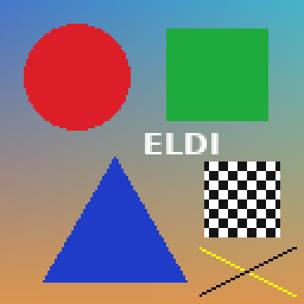
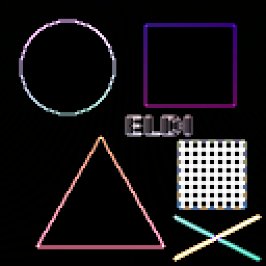
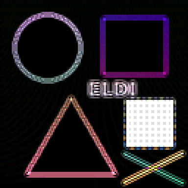
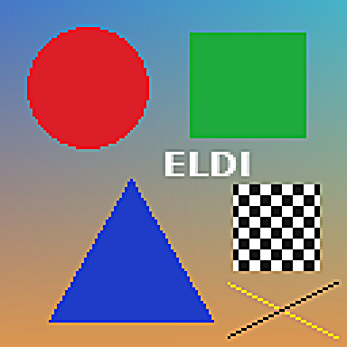
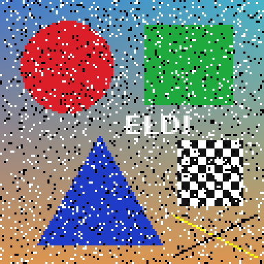

# Procesador de imágenes con filtros en una FPGA

Proyecto final de Electrónica Digital (ELDI), Escuela Colombiana de Ingeniería, 2026-2.
Es el proyecto #8 de la lista del curso: *Image Processor (2D filters)*.

Lo hicimos **Edison Torres** y **Juan Guaman**.

## La idea en pocas palabras

Desde el computador le mandamos una imagen a color a la tarjeta, la tarjeta le aplica un filtro y nos la
devuelve. Todos los cálculos los hace la FPGA (Field-Programmable Gate Array, un chip cuyo circuito interno se
puede configurar). El computador solo abre la imagen, la envía, recibe la respuesta y la muestra. Así nos lo
pidió el profesor.

El recorrido de una imagen es este:

1. Un programa en Python abre la imagen (128 × 128 píxeles, a color) y la manda por el mismo cable USB
   (Universal Serial Bus) con el que se programa la tarjeta. La imagen viaja como 49 152 bytes: tres por cada
   píxel, uno para el rojo, otro para el verde y otro para el azul.
2. La FPGA guarda la imagen en su memoria interna. Si los interruptores lo piden, mientras la guarda le agrega
   ruido de "sal y pimienta", es decir, puntos blancos y negros al azar.
3. La FPGA le aplica el filtro que marquen los interruptores y devuelve el resultado byte por byte, por el
   mismo cable.
4. El programa de Python recibe la imagen filtrada y la muestra al lado de la original.

## Los filtros

| Filtro | Qué le hace a la imagen |
|---|---|
| Gaussiano | La suaviza: queda un poco borrosa y el ruido se nota menos. |
| Laplaciano | Deja solo los bordes. Donde la imagen cambia de golpe se ve claro y lo parejo queda negro. |
| LoG (Laplacian of Gaussian, Laplaciano del Gaussiano) | Primero suaviza y después saca los bordes, así el ruido produce menos bordes falsos. |
| Unsharp (máscara de enfoque) | Le sube la nitidez. |
| Bypass (paso directo) | Devuelve la imagen sin filtrar. Sirve para probar la comunicación y para ver el ruido. |

El enunciado pide usar dos filtros solos y combinados. Los dos filtros base son el Gaussiano y el Laplaciano;
el LoG y el Unsharp son las combinaciones de esos dos.

## Qué se necesita

- Una tarjeta Digilent **Nexys 4 DDR** o **Nexys A7-100T**. Las dos tienen la misma FPGA, una Artix-7
  XC7A100T. Nosotros lo probamos en una Nexys 4 DDR.
- El cable micro-USB de la tarjeta. Por ahí se programa la tarjeta y por ahí viaja la imagen.
- **Vivado 2025.2**, la edición gratuita ML Standard, para armar el proyecto y programar la tarjeta.
- **Python 3** con las librerías pyserial, numpy, pillow y matplotlib (están en `python/requirements.txt`).
- Solo si se quiere simular sin Vivado: **Icarus Verilog** (versión 11 o más nueva) y **GTKWave**, en Linux,
  macOS o WSL (Windows Subsystem for Linux).

## Cómo ponerlo a funcionar, paso a paso

### 1. Descargar el repositorio

En GitHub, botón verde **Code → Download ZIP**, y luego descomprimir el archivo. También se puede con git:

```
git clone https://github.com/felipeedisontorres/ELDI_PROYECTO.git
```

### 2. Crear el proyecto en Vivado

1. Abre Vivado sin abrir ningún proyecto.
2. Abajo, en la **Tcl Console**, escribe esta línea cambiando la ruta por la carpeta donde quedó el
   repositorio. Usa barras `/`, no `\`:
   ```
   source C:/ruta/al/repositorio/vivado/configurar_proyecto.tcl
   ```
   Ese script (escrito en Tcl, Tool Command Language, el lenguaje de comandos de Vivado) crea el proyecto en
   `vivado/proyecto/` con todo listo: el diseño (`rtl/`), las pruebas (`tb/`), los pines de la tarjeta
   (`constraints/`) y el modelo exacto de FPGA (`xc7a100tcsg324-1`). Si ya tenías un proyecto abierto, en vez
   de crear uno nuevo le agrega los archivos y le pone ese modelo de FPGA.
3. Solo si tu tarjeta es la Nexys 4 original (la que no dice DDR): antes de correr el script, ábrelo con un
   editor de texto y cambia la primera línea, `set placa "nexys_a7_100t"`, por
   `set placa "nexys4_original"`.

### 3. Generar el archivo que se carga en la tarjeta

En el panel de la izquierda (**Flow Navigator**) haz clic, en este orden, en **Run Synthesis**,
**Run Implementation** y **Generate Bitstream**. Tarda unos minutos. El *bitstream* es el archivo que convierte
la FPGA en nuestro circuito.

### 4. Programar la tarjeta

1. Conecta la tarjeta al computador con el cable micro-USB y enciéndela con el interruptor POWER.
2. En Vivado, haz clic en **Open Hardware Manager**, luego en **Open Target → Auto Connect**. Después, clic
   derecho sobre **xc7a100t_0 → Program Device… → Program**.
3. **Cuando termine de programar, presiona una vez el botón CPU RESET de la tarjeta.** Si no, la primera imagen
   puede llegar corrida un byte y con los colores cambiados. Más abajo explicamos por qué pasa.

La FPGA se borra cuando la tarjeta se apaga. Si la apagas, hay que repetir este paso.

### 5. Mandar una imagen

Abre una terminal (en Windows sirve el Símbolo del sistema o PowerShell) dentro de la carpeta `python/` y
escribe:

```
pip install -r requirements.txt
python procesar_imagen.py --listar
python procesar_imagen.py imagen_prueba.png --puerto COM5 --filtro G
```

- La primera línea instala las librerías. Solo hace falta la primera vez.
- La segunda muestra los puertos COM (puertos de comunicación) del computador. Ahí aparece el de la tarjeta.
- La tercera envía la imagen. Cambia `COM5` por el puerto que te salió.

En Windows, si el comando `python` no funciona, prueba con `py` (por ejemplo, `py procesar_imagen.py --listar`
y `py -m pip install -r requirements.txt`).

El envío tarda unos 4,3 segundos y la respuesta otro tanto. Después se abre una ventana con la imagen enviada y
la que devolvió la tarjeta, una al lado de la otra. La imagen devuelta y esa comparación quedan guardadas en
`python/resultados/`.

Ojo: `--filtro` solo le pone nombre a la ventana y al archivo. El filtro que se aplica lo eligen los
interruptores de la tarjeta, así que hay que ponerlos antes de enviar.

Para empezar conviene la prueba más sencilla: bypass sin ruido, es decir, solo SW2 arriba. La imagen debe
volver idéntica. Si vuelve igual, la comunicación funciona y ya se pueden probar los filtros.

Sirve cualquier imagen. Si no mide 128 × 128, el programa la ajusta a ese tamaño al abrirla, pero lo mejor es
usar una que ya tenga ese tamaño, como `imagen_prueba.png`.

### 6. Probar otro filtro sin volver a mandar la imagen

La tarjeta se queda con la última imagen que recibió. Para verla con otro filtro:

1. Cambia los interruptores.
2. Ejecuta `python procesar_imagen.py --reprocesar --puerto COM5 --filtro LoG`.
3. Presiona el botón del centro (BTNC) antes de que pasen 30 segundos.

El ruido se agrega mientras la imagen llega. Por eso, para cambiar la cantidad de ruido sí hay que volver a
enviar la imagen.

## Controles de la tarjeta

| Control | Para qué sirve |
|---|---|
| SW1 y SW0 | Eligen el filtro: 00 Gaussiano · 01 Laplaciano · 10 LoG · 11 Unsharp |
| SW2 | Bypass: devuelve la imagen sin filtrar |
| SW4 y SW3 | Cantidad de ruido: 00 nada · 01 el 6,25 % de los píxeles · 10 el 12,5 % · 11 el 18,75 % |
| BTNC (botón del centro) | Vuelve a procesar la última imagen con los interruptores actuales, sin reenviarla |
| CPU RESET | Reinicia todo. Se usa después de programar y si alguna vez llegan menos de 49 152 bytes |
| LED2, LED1 y LED0 | Muestran el modo que se está usando (copian SW2, SW1 y SW0) |
| LED6 y LED7 | LED6 encendido: primera pasada. LED7 encendido: segunda pasada (solo el LoG tiene dos). Los dos apagados: esperando una imagen |

Interruptor arriba es 1 y abajo es 0. Por ejemplo, "SW1 y SW0 = 10" quiere decir SW1 arriba y SW0 abajo.

La tarjeta lee los interruptores mientras está esperando. Cuando empieza a procesar, el modo queda fijo hasta
que termina.

## Cómo probarlo sin la tarjeta (simulación)

Cada bloque del diseño tiene su propio *testbench*: un programa de prueba que le pone entradas al bloque y
revisa solo, ciclo por ciclo, que las salidas sean las correctas. Al final cada uno escribe PASS (pasó) o
FAIL (falló), así que no hace falta mirar las ondas para saber si funciona.

**En Vivado**, después del paso 2: **Flow Navigator → Run Simulation → Run Behavioral Simulation**. La
simulación corre sola hasta el final y en la Tcl Console debe aparecer:

```
TB tb_image_proc_top (W=8, CPB=8): 4441 verificaciones, 0 errores -> PASS
```

Es la prueba del sistema completo con una imagen chiquita de 8 × 8, para que tarde segundos y no minutos.

**Con Icarus Verilog** (Linux, macOS o WSL), desde la carpeta del repositorio:

```
sudo apt install iverilog gtkwave
bash sim/run_all.sh
```

La primera línea instala los programas en Ubuntu o WSL y solo se hace una vez. La segunda corre las 10 pruebas
(una por bloque más la del sistema completo) y debe terminar en `TODOS LOS TESTBENCHES: PASS`.

**Con la imagen completa de 128 × 128** (tarda unos 5 minutos):

```
cd sim/full
iverilog -g2012 -s tb_image_proc_top -o full.vvp -P tb_image_proc_top.LOG_W=7 -P tb_image_proc_top.FULL=1 ../../rtl/*.sv ../../tb/tb_image_proc_top.sv
vvp full.vvp
python3 hex2png.py out_*.hex
```

La simulación guarda la salida de cada modo en archivos `out_*.hex`, y la última línea los convierte en
imágenes `.png` para poder verlas.

**Formas de onda**, para ver las señales por dentro:

```
cd sim/wave
iverilog -g2012 -s tb_wave -o wave.vvp ../../rtl/*.sv tb_wave.sv
vvp wave.vvp
gtkwave wave.vcd
```

En vez de GTKWave también sirve `python3 plot_wave.py wave.vcd .`, que dibuja las mismas señales que salen en
las figuras de la explicación.

## Cómo funciona por dentro

El circuito está hecho solo con piezas que vimos en clase: contadores, registros, registros de desplazamiento,
multiplexores, sumadores, un multiplicador, memorias y una máquina de estados. Está escrito en SystemVerilog,
un lenguaje para describir hardware, con un archivo por bloque en `rtl/`:

| Bloque | Qué hace |
|---|---|
| `uart_rx` | Recibe los bits que llegan por el cable y arma cada byte. UART (Universal Asynchronous Receiver-Transmitter) es el tipo de comunicación serial que usa el cable. |
| `noise_gen` | Decide al azar si el píxel que llega se vuelve blanco o negro (el ruido). Para el azar usa un LFSR (Linear Feedback Shift Register), un registro de desplazamiento realimentado que produce una secuencia que parece aleatoria. |
| `pos_counter` | Lleva la cuenta de por dónde va: fila, columna y color (rojo, verde o azul). |
| `bram_sdp` | Las dos memorias internas (BRAM, Block RAM). BRAM_IN guarda la imagen que llegó y BRAM_TMP guarda el resultado intermedio del LoG. |
| `tap_seq` | Para cada byte le pide a la memoria sus 9 vecinos: el píxel mismo y los 8 que lo rodean. En los bordes repite el píxel del borde. |
| `conv_mac` | Multiplica cada vecino por su peso en el filtro y va sumando. MAC viene de Multiply-Accumulate: multiplicar y acumular. |
| `post_proc` | Divide el resultado entre 16, le quita el signo cuando el filtro lo necesita y lo deja entre 0 y 255. |
| `uart_tx` | Manda el byte de vuelta al computador, bit por bit. |
| `ctrl` | La máquina de estados que dirige todo: espera la imagen, hace la primera pasada y, solo en el LoG, una segunda pasada. |
| `image_proc_top` | Conecta todos los bloques entre sí y con los pines de la tarjeta. |

Cada filtro es una tabla de 9 pesos (3 × 3). Por ejemplo, el Gaussiano usa esta tabla y al final divide
entre 16:

```
1 2 1
2 4 2
1 2 1
```

Todos los filtros usan el mismo multiplicador y el mismo sumador; lo único que cambia es la tabla de pesos. El
LoG necesita dos pasadas: en la primera aplica el Gaussiano y guarda el resultado en BRAM_TMP, y en la segunda
le aplica el Laplaciano a eso y lo envía.

Para leer el código conviene tener al lado el esquemático (`docs/esquematico/esquematico_v4_1.pdf`) y la
explicación bloque por bloque (`docs/explicacion/Explicacion_v4_1.pdf`). Las señales se llaman igual en los
tres.

## Resultados

**En simulación.** Las 10 pruebas pasan. Con la imagen completa de 128 × 128, la salida de los cinco modos,
con ruido y sin ruido, es igual byte por byte a la de un modelo de referencia escrito dentro del testbench:
491 529 comparaciones y 0 errores.

**En Vivado.** El diseño usa muy poco de la FPGA: 313 LUT (Look-Up Tables, las celdas de lógica de la FPGA),
137 flip-flops y 32 bloques de memoria, que son el 23,7 % de la memoria interna. Funciona con el reloj de
100 MHz de la tarjeta y al camino más lento todavía le sobran 2,1 nanosegundos.

**En la tarjeta** (23 de noviembre de 2026, Nexys 4 DDR). Enviamos una imagen de prueba de 128 × 128 en los
cinco modos, sin ruido. Gaussiano, Laplaciano, LoG, Unsharp y bypass devolvieron exactamente los bytes
esperados: 0 bytes distintos de 49 152 en cada modo. Cada imagen tardó unos 4,6 segundos en volver. Con el
ruido encendido, en bypass cambió cerca del 14 % de los bytes, como se espera cuando se agrega ruido (eso lo
revisamos a simple vista). El detalle está en [`docs/04_verificacion.md`](docs/04_verificacion.md).

Así se ven las salidas en la simulación con la imagen completa:

| Imagen original | Gaussiano | Laplaciano |
|---|---|---|
|  |  |  |
| **LoG** (aclarado 4 veces solo para que se vea) | **Unsharp** | **Con ruido** (12,5 %) |
|  |  |  |

El LoG de verdad sale muy oscuro, y está bien que así sea: como primero suaviza, los bordes que quedan son
suaves. En la tabla está multiplicado por 4 solo para poder verlo.

## Algo que aprendimos en la prueba con la tarjeta

La primera vez que mandamos una imagen justo después de programar la tarjeta llegaron 49 151 bytes en vez de
49 152, y los colores salieron cambiados porque cada byte quedó en el lugar del anterior. Los envíos siguientes
salieron perfectos.

La causa está en el transmisor (`rtl/uart_tx.sv`). El registro que va sacando los bits (`sr_tx`) solo se llena
de unos con el reset. Recién programada la FPGA ese registro está en 0, así que la línea de salida se queda en
0 hasta el primer envío. Cuando llega el primer byte, su bit de inicio (que también es un 0) no se nota, y el
computador pierde ese byte. Con un reset, el registro arranca en unos, que es como debe estar la línea en
reposo, y todo funciona desde la primera imagen.

Como la entrega estaba encima, decidimos no tocar el circuito y presionar CPU RESET después de programar. Es la
decisión D37 de [`docs/03_decisiones.md`](docs/03_decisiones.md).

## Qué hay en cada carpeta

| Carpeta o archivo | Qué tiene |
|---|---|
| `rtl/` | El diseño del circuito, un archivo por bloque. El principal es `image_proc_top.sv`. |
| `tb/` | Las pruebas (testbenches): una por bloque y una del sistema completo. |
| `sim/` | `run_all.sh` corre todas las pruebas con Icarus Verilog; `full/` es la prueba con la imagen completa; `wave/` dibuja las formas de onda; `syn.ys` es una síntesis de prueba con Yosys (un programa libre de síntesis), solo para estimar recursos. |
| `constraints/` | Los pines de la tarjeta, en archivos XDC (Xilinx Design Constraints). Salen del archivo oficial de Digilent ([github.com/Digilent/digilent-xdc](https://github.com/Digilent/digilent-xdc)); no escribimos ningún pin a mano. Usamos el de la Nexys A7-100T (la Nexys A7 es el nombre nuevo de la Nexys 4 DDR) y con ese hicimos la prueba en nuestra Nexys 4 DDR. El otro archivo es para la Nexys 4 original. |
| `vivado/` | El script que arma el proyecto de Vivado. |
| `python/` | El programa del computador (`procesar_imagen.py`), la imagen de prueba y la lista de librerías. |
| `docs/` | La documentación (ver la tabla de abajo). |
| `AI_USAGE.md` | Cómo usamos la inteligencia artificial en el proyecto. |

| Documento | Qué tiene |
|---|---|
| [`docs/01_requisitos.md`](docs/01_requisitos.md) | Los requisitos del curso y del proyecto, y cómo cumplimos cada uno. |
| [`docs/02_arquitectura.md`](docs/02_arquitectura.md) | El resumen de cómo está armado el circuito. |
| [`docs/03_decisiones.md`](docs/03_decisiones.md) | Las decisiones de diseño: qué escogimos, qué descartamos y por qué. |
| [`docs/04_verificacion.md`](docs/04_verificacion.md) | Cómo probamos cada parte y qué dio cada prueba, incluida la prueba en la tarjeta. |
| [`docs/esquematico/esquematico_v4_1.pdf`](docs/esquematico/esquematico_v4_1.pdf) | El esquemático completo en una hoja A1, con el ancho de cada bus (cuántos bits lleva cada conexión). El programa que lo dibuja está en `generador/`. |
| [`docs/explicacion/Explicacion_v4_1.pdf`](docs/explicacion/Explicacion_v4_1.pdf) | La explicación bloque por bloque: cómo funciona cada uno, el recorrido de un byte ciclo a ciclo, las pruebas, cómo cumplimos los tiempos y las preguntas que esperamos en la sustentación. |

## Uso de inteligencia artificial

Usamos Claude, de Anthropic, como tutor y como apoyo para diseñar, escribir el código y documentar. El
profesor lo permitió con la condición de que entendamos todo el código. En [`AI_USAGE.md`](AI_USAGE.md) está el
registro completo: para qué la usamos, cuándo y qué archivos generó.
