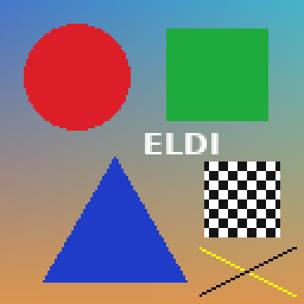
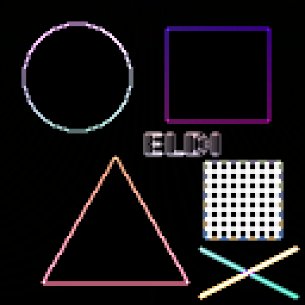
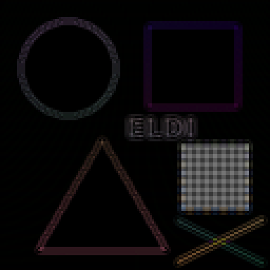
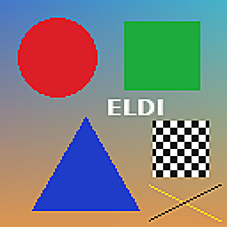
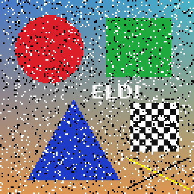
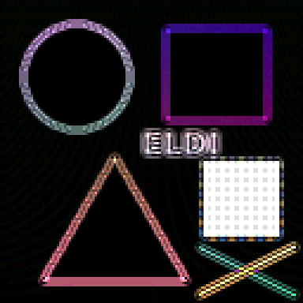

# Verificación

Cada módulo tiene un testbench **autoverificable**: compara las salidas con lo esperado en cada ciclo,
cuenta las verificaciones y los errores, y termina imprimiendo `PASS` o `FAIL`. No hay que mirar ondas
para saber si funciona. Las ondas sirven para entender y explicar (ver `sim/wave/`).

## 1. Testbenches por módulo

Se corren todos con `bash sim/run_all.sh` (Icarus Verilog 12, `-g2012`).

| Testbench | Qué prueba | Verificaciones | Resultado |
|---|---|---|---|
| `tb_uart_rx` | Los 256 valores seguidos sin pausa, pausas aleatorias, error de baudios de ±3 %, muestreo a mitad de bit, pulso `rx_valid` de 1 ciclo, línea en reposo sin bytes falsos y reset en medio de un byte | 397 | PASS |
| `tb_uart_tx` | La línea `tx` ciclo a ciclo contra la forma de onda ideal 8N1 (inicio, 8 datos con el LSB primero, parada, cada bit exactamente `CLKS_PER_BIT` ciclos): los 256 valores, envíos seguidos, pausas aleatorias, reposo en 1 tras el reset y duración de `busy` | 2 510 598 | PASS |
| `tb_noise_gen` | Periodo del LFSR = 65 535 y nunca 0; número **exacto** de aciertos por nivel en un periodo (0, 4 095, 8 191, 12 287); salida igual a un modelo independiente con entradas aleatorias; los 3 bytes de un píxel reciben la misma decisión; nivel 0 = sin ruido | 613 697 | PASS |
| `tb_pos_counter` | Instancias de 128 × 128 y de 8 × 8 con enable aleatorio: secuencia R, G, B → columna → fila; `fin` solo al avanzar desde el último byte; vuelta a (0, 0, 0); `en = 0` congela; dos barridos completos | 393 298 | PASS |
| `tb_bram_sdp` | Latencia de lectura de 1 ciclo, escritura y lectura simultáneas, lectura justo después de escribir, direcciones extremas (0 y 65 535), contenido inicial 0 y colisión en la misma dirección | 431 081 | PASS |
| `tb_tap_seq` | **Exhaustivo:** todas las filas y columnas de 128 × 128 (esquinas y bordes incluidos), los 3 canales y los 12 taps. TAP cuenta 0..11, se queda en 11 hasta `go`, `go` lo devuelve a 0 desde cualquier valor y en IDLE no cuenta | 221 170 | PASS |
| `tb_conv_mac` | Los 4 kernels con vecindarios aleatorios y extremos (todo 0, todo 255, centro 255 y vecinos 0, centro 0 y vecinos 255, damero). Suma en el tap 11 contra una tabla de pesos escrita aparte; el ACC se mantiene en el tap 11 aunque cambie el píxel; extremos ±16 320 del Laplaciano; `tap = 0` lo borra | 36 073 | PASS |
| `tb_post_proc` | **Exhaustivo:** los 32 768 valores posibles del ACC (15 b con signo) con `absm = 0` y `absm = 1` | 65 536 | PASS |
| `tb_ctrl` | Los 8 valores de SW[2:0]; transiciones IDLE → P1 → (P2) → IDLE con `fin`; arranque con BTNC; BTNC ignorado en P1/P2; MODE congelado fuera de IDLE; salidas del decodificador contra la tabla de verdad | 157 | PASS |
| `tb_image_proc_top` | Sistema completo con imagen de 8 × 8 (ver sección 2) | 4 441 | PASS |

Salida de `sim/run_all.sh`:

```
tb_uart_rx             TB tb_uart_rx: 397 verificaciones, 0 errores -> PASS
tb_uart_tx             TB tb_uart_tx: 2510598 verificaciones, 0 errores -> PASS
tb_noise_gen           TB tb_noise_gen: 613697 verificaciones, 0 errores -> PASS
tb_pos_counter         TB tb_pos_counter: 393298 verificaciones, 0 errores -> PASS
tb_bram_sdp            TB tb_bram_sdp: 431081 verificaciones, 0 errores -> PASS
tb_tap_seq             TB tb_tap_seq: 221170 verificaciones, 0 errores -> PASS
tb_conv_mac            TB tb_conv_mac: 36073 verificaciones, 0 errores -> PASS
tb_post_proc           TB tb_post_proc: 65536 verificaciones, 0 errores -> PASS
tb_ctrl                TB tb_ctrl: 157 verificaciones, 0 errores -> PASS
tb_image_proc_top      TB tb_image_proc_top (W=8, CPB=8): 4441 verificaciones, 0 errores -> PASS
--------------------------------------------------------------
TODOS LOS TESTBENCHES: PASS
```

## 2. Sistema completo (`tb_image_proc_top`)

La imagen entra **bit a bit por el pin `UART_TXD_IN`** y la respuesta se decodifica bit a bit desde el pin
`UART_RXD_OUT`, igual que en la tarjeta. Cada byte se compara con un **modelo de referencia** escrito dentro
del testbench (convolución 3×3 con borde replicado, ÷16 por piso, valor absoluto o recorte y saturación a 255).
El modelo solo existe en el testbench, no en el sistema (R-F01).

**Modo rápido (por defecto, el que corre Vivado):** imagen de 8 × 8 y 8 ciclos por bit (D14). Prueba
Gaussiano, Laplaciano, LoG, Unsharp, bypass (con SW = 100 y 111) usando BTNC, una imagen de valores extremos,
el ruido en los 3 niveles (estructura, densidad y contenido exacto de BRAM_IN), los filtros sobre la imagen
con ruido, bytes que llegan durante el procesamiento (se ignoran), BTNC sostenido durante el procesamiento
(se ignora), los LED, el contenido de BRAM_TMP en el LoG y la temporización de la salida.

**Imagen completa de 128 × 128** (`sim/full/`, unos 5 minutos):

```
  G       : 49152/49152 bytes iguales al modelo
  L       : 49152/49152 bytes iguales al modelo
  LoG     : 49152/49152 bytes iguales al modelo
  US      : 49152/49152 bytes iguales al modelo
  bypass  : 49152/49152 bytes iguales al modelo
  ruido   : 49152/49152 bytes iguales al modelo   (2105 de 16384 píxeles con ruido: 12,85 %, nivel 2 = 12,5 %)
  G-ruido : 49152/49152 bytes iguales al modelo
  LoG-ruid: 49152/49152 bytes iguales al modelo
TB tb_image_proc_top (W=128, CPB=8): 491529 verificaciones, 0 errores -> PASS
```

Resultados de la simulación (imagen de entrada y salidas de la FPGA simulada):

| Entrada | Gaussiano | Laplaciano | LoG |
|---|---|---|---|
|  |  |  |  |

| Unsharp | Con ruido (12,5 %) | Gaussiano sobre el ruido | LoG ×4 (para ver mejor los bordes) |
|---|---|---|---|
|  |  |  |  |

El LoG sale oscuro y es lo esperado: el Gaussiano suaviza antes de derivar, así que los bordes quedan con
poca amplitud. La última imagen lo multiplica por 4 solo para poder verlo.

## 3. Vivado 2025.2

| Paso | Resultado |
|---|---|
| Simulación del sistema en xsim | `TB tb_image_proc_top (W=8, CPB=8): 4441 verificaciones, 0 errores -> PASS` |
| Síntesis e implementación (`xc7a100tcsg324-1`) | 313 LUT · 137 FF · 32 RAMB36 (23,7 %) · 0 DSP · 18 IOB |
| Tiempos a 100 MHz | v4: WNS −1,669 ns (no cumplía) → **v4.1: WNS +2,112 ns (cumple)**. Ver D36 en [`03_decisiones.md`](03_decisiones.md) |
| Bitstream | Generado |

Vivado armó el multiplicador con LUT en lugar de usar un bloque DSP48. No afecta el funcionamiento.

## 4. Pendiente

- Prueba en la tarjeta: programar el bitstream y enviar imágenes reales con `python/procesar_imagen.py`
  en los cinco modos y los cuatro niveles de ruido.
- Correr en xsim los testbenches de cada módulo (en Vivado solo se ha corrido el del sistema).
