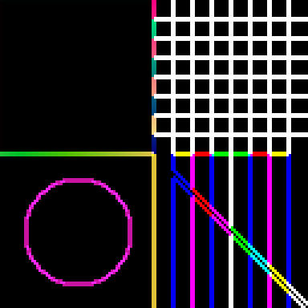
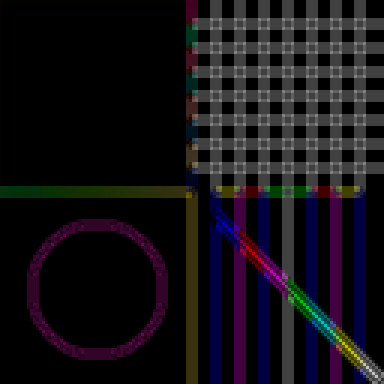

# Verificación: cómo probamos que funciona

Probamos el diseño en tres niveles: cada bloque por separado, el sistema completo en simulación y, al final,
la tarjeta de verdad.

Cada bloque tiene un *testbench* (programa de prueba) que se revisa solo: en cada ciclo compara las salidas con
lo que deberían ser, cuenta cuántas verificaciones hizo y cuántos errores encontró, y al final escribe `PASS`
(pasó) o `FAIL` (falló). No hace falta mirar las formas de onda para saber si funciona; las ondas sirven para
entender y explicar (ver `sim/wave/`).

## 1. Testbenches por módulo

Se corren todos juntos con `bash sim/run_all.sh` (Icarus Verilog 12, opción `-g2012`).

| Testbench | Qué prueba | Verificaciones | Resultado |
|---|---|---|---|
| `tb_uart_rx` | Los 256 valores seguidos sin pausa, pausas aleatorias, error de baudios de ±3 %, muestreo a mitad de bit, pulso `rx_valid` de 1 ciclo, línea en reposo sin bytes falsos y reset en medio de un byte | 397 | PASS |
| `tb_uart_tx` | La línea `tx` ciclo a ciclo contra la forma de onda ideal 8N1 (inicio, 8 datos con el LSB primero, parada, cada bit exactamente `CLKS_PER_BIT` ciclos): los 256 valores, envíos seguidos, pausas aleatorias, reposo en 1 tras el reset y duración de `busy` | 2 510 598 | PASS |
| `tb_noise_gen` | Periodo del LFSR = 65 535 y nunca 0; número **exacto** de aciertos por nivel en un periodo (0, 4 095, 8 191, 12 287); salida igual a un modelo independiente con entradas aleatorias; los 3 bytes de un píxel reciben la misma decisión; nivel 0 = sin ruido | 613 697 | PASS |
| `tb_pos_counter` | Instancias de 128 × 128 y de 8 × 8 con enable aleatorio: secuencia R, G, B → columna → fila; `fin` solo al avanzar desde el último byte; vuelta a (0, 0, 0); `en = 0` congela; dos barridos completos | 393 298 | PASS |
| `tb_bram_sdp` | Latencia de lectura de 1 ciclo, escritura y lectura simultáneas, lectura justo después de escribir, direcciones extremas (0 y 65 535), contenido inicial 0 y colisión en la misma dirección | 431 081 | PASS |
| `tb_tap_seq` | **Exhaustivo:** todas las filas y columnas de 128 × 128 (esquinas y bordes incluidos), los 3 canales y los 12 taps. TAP cuenta 0..11, se queda en 11 hasta `go`, `go` lo devuelve a 0 desde cualquier valor y en IDLE no cuenta | 221 170 | PASS |
| `tb_conv_mac` | Los 4 kernels con vecindarios aleatorios y extremos (todo 0, todo 255, centro 255 y vecinos 0, centro 0 y vecinos 255, damero). Suma en el tap 11 contra una tabla de pesos escrita aparte; el ACC se mantiene en el tap 11 aunque cambie el píxel; extremos ±16 320 del Laplaciano; `tap = 0` lo borra | 36 073 | PASS |
| `tb_post_proc` | **Exhaustivo:** los 32 768 valores posibles del ACC (15 b con signo) con `absm = 0` y `absm = 1` | 65 536 | PASS |
| `tb_ctrl` | Los 8 valores de SW[2:0]; transiciones IDLE → P1 → (P2) → IDLE con `fin`; arranque con BTNC; BTNC ignorado en P1/P2; MODE congelado fuera de IDLE; salidas del decodificador contra la tabla de verdad | 157 | PASS |
| `tb_image_proc_top` | Sistema completo con imagen de 8 × 8 (ver sección 2) | 4 441 | PASS |

Salida de `sim/run_all.sh`:

```
tb_uart_rx             TB tb_uart_rx: 397 verificaciones, 0 errores -> PASS
tb_uart_tx             TB tb_uart_tx: 2510598 verificaciones, 0 errores -> PASS
tb_noise_gen           TB tb_noise_gen: 613697 verificaciones, 0 errores -> PASS
tb_pos_counter         TB tb_pos_counter: 393298 verificaciones, 0 errores -> PASS
tb_bram_sdp            TB tb_bram_sdp: 431081 verificaciones, 0 errores -> PASS
tb_tap_seq             TB tb_tap_seq: 221170 verificaciones, 0 errores -> PASS
tb_conv_mac            TB tb_conv_mac: 36073 verificaciones, 0 errores -> PASS
tb_post_proc           TB tb_post_proc: 65536 verificaciones, 0 errores -> PASS
tb_ctrl                TB tb_ctrl: 157 verificaciones, 0 errores -> PASS
tb_image_proc_top      TB tb_image_proc_top (W=8, CPB=8): 4441 verificaciones, 0 errores -> PASS
--------------------------------------------------------------
TODOS LOS TESTBENCHES: PASS
```

## 2. Sistema completo (`tb_image_proc_top`)

La imagen entra **bit a bit por el pin `UART_TXD_IN`** y la respuesta se lee bit a bit en el pin
`UART_RXD_OUT`, igual que pasa en la tarjeta. Cada byte que sale se compara con un **modelo de referencia**
escrito dentro del testbench, que calcula lo mismo por otro camino: la tabla de 3 × 3 con el borde repetido, la
división entre 16 redondeando hacia abajo, el valor absoluto o el recorte, y el límite de 255. Ese modelo solo
existe en la prueba, no en el circuito (R-F01).

**Prueba rápida** (la que corre por defecto y la que corre Vivado): imagen de 8 × 8 y 8 ciclos de reloj por
bit (D14), para que tarde segundos. Prueba el Gaussiano, el Laplaciano, el LoG, el Unsharp y el bypass (con los
interruptores en 100 y en 111) usando BTNC; una imagen con valores extremos; los 3 niveles de ruido (dónde
cae, cuánto hay y qué queda guardado exactamente en BRAM_IN); los filtros sobre la imagen con ruido; bytes que
llegan mientras procesa (se ignoran); BTNC sostenido mientras procesa (se ignora); los LED; lo que queda en
BRAM_TMP en el LoG, y el ritmo al que salen los bytes.

**Imagen completa de 128 × 128** (`sim/full/`, unos 5 minutos):

```
  G       : 49152/49152 bytes iguales al modelo
  L       : 49152/49152 bytes iguales al modelo
  LoG     : 49152/49152 bytes iguales al modelo
  US      : 49152/49152 bytes iguales al modelo
  bypass  : 49152/49152 bytes iguales al modelo
  ruido   : 49152/49152 bytes iguales al modelo   (2105 de 16384 píxeles con ruido: 12,85 %, nivel 2 = 12,5 %)
  G-ruido : 49152/49152 bytes iguales al modelo
  LoG-ruid: 49152/49152 bytes iguales al modelo
TB tb_image_proc_top (W=128, CPB=8): 491529 verificaciones, 0 errores -> PASS
```


## 3. Vivado 2025.2

| Paso | Resultado |
|---|---|
| Simulación del sistema en xsim (el simulador de Vivado) | `TB tb_image_proc_top (W=8, CPB=8): 4441 verificaciones, 0 errores -> PASS` |
| Síntesis e implementación (`xc7a100tcsg324-1`) | 313 LUT · 137 flip-flops · 32 RAMB36 (23,7 %) · 0 DSP · 18 IOB (qué es cada uno: ver [`02_arquitectura.md`](02_arquitectura.md)) |
| Tiempos a 100 MHz | WNS (Worst Negative Slack, lo que le sobra al camino más lento). v4: −1,669 ns, no cumplía → **v4.1: +2,112 ns, cumple**. Ver D36 en [`03_decisiones.md`](03_decisiones.md) |
| Bitstream | Generado |

Vivado armó el multiplicador con LUT (celdas de lógica) en lugar de usar un bloque DSP48 (bloque de
multiplicación). No afecta el funcionamiento.

## 4. Prueba en la tarjeta (23 de noviembre de 2026)

**Montaje.** Tarjeta Nexys 4 DDR (Vivado la reconoce como `xc7a100t_0`), programada con el bitstream de la
versión 4.1 y el archivo de pines `constraints/nexys_a7_100t.xdc`. La tarjeta quedó en el puerto COM6 del
computador, que es el puente USB-UART que trae la tarjeta.

**Programa usado.** Para esta prueba usamos un script aparte, `prueba_fpga.py`, que solo usa la biblioteca
estándar de Python, porque el Python de IDLE de ese computador no tenía pyserial, numpy ni pillow. Esa primera
versión generaba una imagen de prueba de 128 × 128 (un degradado de colores, un tablero de 8 × 8, un disco y
barras de colores), enviaba los 49 152 bytes, recibía la respuesta, la guardaba en PNG y la mostraba. Solo para
esta prueba también comparaba la respuesta con un modelo de los filtros escrito en Python, para saber si la
tarjeta calculaba bien. Ese modelo nunca fue parte del sistema.

Después de la prueba hicimos una versión corta para la demostración, que es la que está en el repositorio
(`python/prueba_fpga.py`). Ya no tiene el modelo ni genera imágenes: solo abre una imagen de 128 × 128, la
envía, recibe la respuesta y muestra las dos (R-F01). Usa el mismo protocolo que la versión de la prueba y que
`python/procesar_imagen.py`: los mismos 49 152 bytes a 115 200 baudios.

**Resultados sin ruido** (SW4 y SW3 en 00):

| Modo | Interruptores | Bytes distintos al modelo |
|---|---|---|
| Gaussiano | SW1 SW0 = 00 | 0 de 49 152 |
| Laplaciano | SW1 SW0 = 01 | 0 de 49 152 |
| LoG | SW1 SW0 = 10 | 0 de 49 152 |
| Unsharp | SW1 SW0 = 11 | 0 de 49 152 |
| Bypass | SW2 = 1 | 0 de 49 152 |

Estas son las imágenes que devolvió la tarjeta, aumentadas 3 veces para verlas mejor (las originales de
128 × 128 están en [`prueba_tarjeta/`](prueba_tarjeta)). En bypass la imagen vuelve idéntica, así que la
primera es también la imagen que se envió:

| Entrada (bypass) | Gaussiano | Laplaciano | LoG | Unsharp |
|---|---|---|---|---|
|  |  |  |  |  |

- Cada imagen tardó unos 4,64 segundos en volver.
- Con el ruido encendido, en bypass cambió cerca del 14 % de los bytes respecto a la imagen enviada, que es lo
  esperado cuando se agrega ruido. Esto lo revisamos a simple vista.
